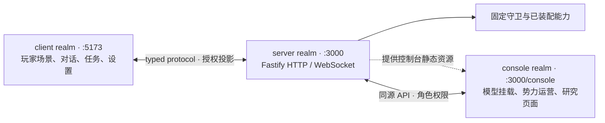
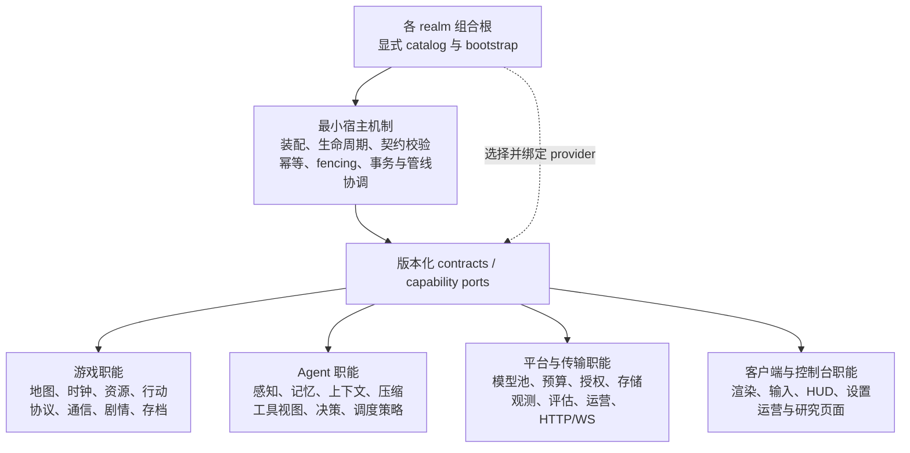
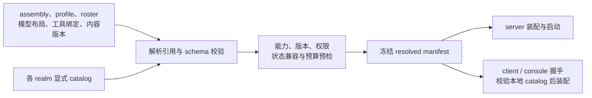
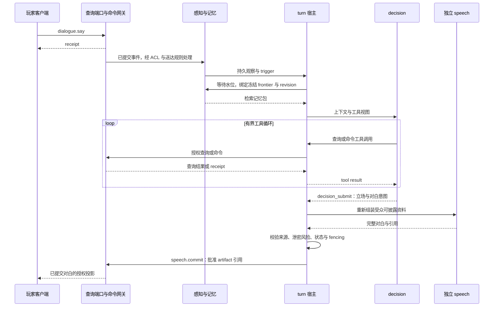
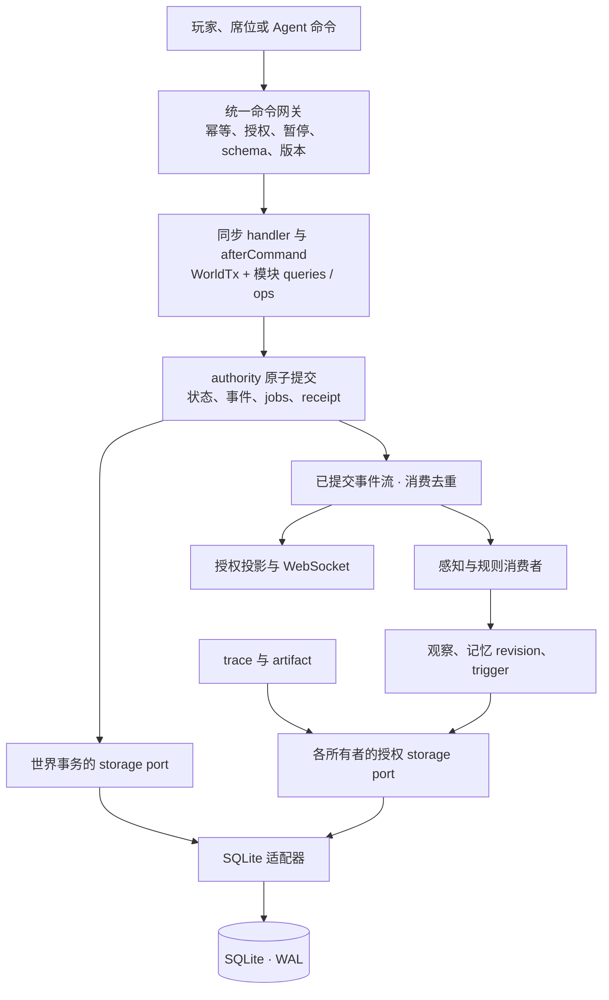
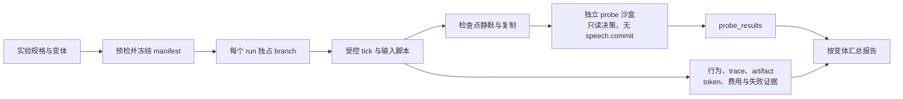

# ai-npc-demo

一个 TypeScript 全栈的单玩家轻数值 SLG（3D 斜俯视是目标，2.5D 是序章灰盒），以及可观测、可评估、可调试的研究控制台。NPC 根据自己的立场、感知与经历行动；研究者可以追溯行为所依据的观察、记忆、工具结果和模型调用。

> 完整游戏设计、Demo 切片范围与工程文档的权威链见 [docs/README.md — 文档导航](docs/README.md#1-三层结构与全局入口)。

> 玩家可以在 `127.0.0.1:5173` 完成公社开局、查看授权投影并与岑雁等角色交谈。标准装配使用确定性决策与安全模板。测试装配用本地夹具验证模型决策、工具循环和独立对白。`127.0.0.1:3000/console/` 提供运行总览、模块装配、世界时间线和 Agent 状态。序章使用 `standard-15`，默认每 20 秒推进一个 tick，在 t168 评估后暂停。参见 [IMPLEMENTATION-STATUS.md — 实现状态与迁移清单](docs/IMPLEMENTATION-STATUS.md)。

## 一眼看懂

| 方面 | 首版设计 |
|---|---|
| 世界 | 2964 年的地球，五个人类派系与巡裔、根庭、泊星者在灰港周边共处 |
| 玩家 | 公社党魁，参与序章“水闸之前”；设计支持五席，本切片只开放公社 |
| 规模 | 7 个游戏日、6 个地点、3 种已结算资源；8 名支持者 + 4 名 AI 党魁 + 3 名外域，共 15 个 Agent 身份 |
| 玩法 | 交谈、出示证据、签订协议、邀请角色、派遣运输/护送/救援/修复/侦察 |
| NPC | 可接受、拒绝、讨价还价；记忆策略影响关系、回忆与主动提醒 |
| 研究 | 比较记忆策略及其他模块实现，同时记录行为、证据、失败与成本 |
| 架构 | 最小宿主 + 全职能插件，不限于 memory；解耦优先于内聚 |

## 1. 三个 realm，两个本地端口



- `127.0.0.1:5173`：玩家界面与必要设置；开发时 Vite 将 `/api` 代理到服务端。
- `127.0.0.1:3000`：唯一服务端入口，同时提供 `/console/` 控制台资源。控制台构建不新增监听端口。
- 玩家只获得授权投影；控制台按角色与 scope 开放模型挂载、三方势力运营、观测、评估和调试，不能因为进入后台就绕过权限。
- 模型密钥留在服务端，浏览器不能直接访问数据库或模型供应商凭据。

来源：[双端部署](docs/architecture/two-endpoints.md)、[API 与权限](docs/architecture/api.md)。本文流程图的箭头表示调用或数据流，虚线表示装配或资源供应，不表示源码 import。

## 2. 宿主与全职能插件



像主机通过统一接口连接不同设备：**框架保留，更换职能实现不要求消费者了解其内部结构。** capability port 是代码契约，不是网络监听端口；各 realm 独立装配，不共享跨进程 DI 对象。

| 边界 | 规则 |
|---|---|
| 固定机制 | `kernel`、`authority`、`agent-runtime` 等负责协调与不可绕过的守卫，不包含具体游戏策略 |
| 可替换职能 | 每个 provider 声明能力、依赖、配置、生命周期和状态所有权；不复制第二套 runtime |
| 源码依赖 | 只经允许的公开入口；禁止跨模块实现导入、深层导入、循环依赖和共享可变状态 |
| 运行时依赖 | `requires` 校验能力闭包，`requiresRemote` 校验远程契约；不能替代包依赖与源码检查 |
| 状态与技术 | 模块维护自己的 schema 与迁移；第三方 SDK 留在适配器内部，不泄漏到公共 port |
| 替换验证 | 首版比较剧情节奏、HUD、观测页面与四组 memory，验证行为及证据而非只验证选项变化 |

来源：[模块边界](docs/architecture/modules.md)、[模块目录](docs/architecture/module-catalog.md)、[依赖白名单](docs/delivery/tech-stack.md)。

## 3. 配置如何装配成一次运行



| 配置 | 负责什么 |
|---|---|
| assembly | 整个系统的模块组合，覆盖 server、client、console |
| profile | Agent 的感知、记忆、上下文、决策等策略子配方 |
| roster | 本次运行激活的身份及其 profile、工具集引用 |
| model-layout | 集中模型池，按 `(Agent, 用途)` 挂载模型 |
| toolset | 工具定义的绑定、权限和预算限制 |
| RunSpec / manifest | 运行输入与最终解析结果，记录可比较配置、版本和 seed |

缺少必需能力或版本不兼容时明确失败，不静默换实现。可比较配置随 run 冻结；有状态替换在受控暂停点通过新 run 或后继 branch 完成，不承诺任意热拔。

来源：[组合规范](docs/architecture/composition.md)、[配置格式](docs/platform/configuration.md)、[模型池](docs/agent/model-pool.md)。

## 4. 一次 NPC 交互的完整链路

玩家向岑雁请求护送。话语先成为世界事件，再按接收资格、中继延迟与感知策略形成观察；角色基于自己的经历决策，不直接读取全世界历史。



**decision 与 speech 隔离。** decision 可使用角色合法持有的秘密，但自由文本理由、携密历史不能直接交给 speech。speech 没有世界命令工具；完整对白通过校验并持久提交后才展示，不直接展示流式 token。确定性决策路径使用安全模板，不调用真实模型。

记忆策略可替换，但观察游标、冻结输入与必要就绪检查不能被无记忆组跳过；也不能向 M0 偷渡完整历史，使实验失去可比性。

来源：[运行时](docs/agent/runtime.md)、[感知](docs/agent/perception.md)、[记忆](docs/agent/memory.md)、[上下文](docs/agent/context.md)、[对白安全](docs/agent/prompts.md)。

## 5. 世界事实、事件与持久化



- **世界写入只有一条权威路径**，规则模块不能自行提交数据库；事务内不调用模型、不进行网络 I/O、不 `await`。
- `accepted` 只表示命令受理，任务是否完成以状态和后续事件为准。普通规则拒绝回滚命令变更并保存 rejected receipt；非领域异常回滚整个事务，不伪造成功回执。
- 记忆、trace 等自有状态也经授权 storage port 持久化，但不是世界事实写入，不能统称为 authority 的业务状态。
- 事件消费依赖游标与去重，不承诺网络 exactly-once。记忆按不可变 revision 读取，以 CAS 发布更新。
- 快照、恢复与实验采用分支复制，保留世界、认知和控制记录的一致恢复点；恢复不覆盖旧历史。

来源：[领域模型](docs/architecture/domain-model.md)、[存储](docs/architecture/storage.md)、[事件与状态](docs/architecture/events-and-state.md)。

## 6. 观测、评估与实验对比



| 能力 | 展示与比较内容 |
|---|---|
| 可观测 | 输入 frontier、观察来源、记忆引用、工具调用、receipt、模型 attempt |
| 可定位 | 通过 trace 串联一次行为各阶段，区分规则拒绝、模型失败、预算耗尽和过期结果 |
| 可评估 | 回忆、遗漏、编造、泄密、行为差异、证据完整性与成本，指标带分母 |
| 可对比 | M0 无长期记忆、M1 结构化账本、M2 观察流与反思、M3 分层混合 |
| 可调试 | 暂停、单步、快照、恢复、探针与运行记录；调试不绕过安全边界 |
| 可运营 | 模型挂载、剧情发布、三支非人类势力席位接管及审计 |

探针不向正式分支发布对白，沙盒逐个执行并释放身份配额。固定 seed 与输入用于控制变量，不保证真实模型逐字确定性重放。失败、fallback、模型替换与运营干预单列；证据不足不能报告为有效提升。

来源：[评估](docs/platform/evaluation.md)、[观测](docs/platform/observability.md)、[运营](docs/platform/operations.md)。

## 技术栈与适配器边界

| 技术 | 职责 |
|---|---|
| TypeScript、pnpm workspaces | 全栈类型契约与模块包管理 |
| Node.js、tsx | 服务端与工程脚本运行 |
| Fastify、HTTP / WebSocket | API、事件推送、控制台资源供应，封装在传输适配器 |
| SQLite、node:sqlite、WAL | 单写者事务存储与一致备份，封装在存储适配器 |
| Zod、YAML | 命令、配置、内容和模型输出校验，数据驱动装配 |
| React、Vite | 玩家端与控制台模块化页面及构建 |
| PixiJS | 2.5D 灰盒场景，不参与世界规则裁决；3D 渲染器实现同一端口 |
| Anthropic SDK、OpenAI-compatible fetch | 两类参考模型传输适配器，业务层不依赖供应商类型 |
| Vitest、Playwright | 确定性契约、集成、场景测试与双端 e2e |

版本与依赖白名单以 [技术栈](docs/delivery/tech-stack.md) 为准。常规测试使用确定性适配器；真实模型连通性与人工体验验证单独执行，不把模型逐字输出作为稳定断言。

## 目标仓库结构

```text
ai-npc-demo/
├── apps/                       # 组合根与宿主壳
│   ├── server/                 # :3000 API 与控制台资源
│   ├── client/                 # :5173 玩家端
│   └── console/                # 控制台浏览器应用，不新增端口
├── packages/                   # 公共契约、SDK 与固定机制
│   ├── contracts/              # DTO 与 port 契约
│   ├── kernel/                 # 能力图与生命周期
│   ├── module-sdk/             # 服务端模块实现边界
│   ├── client-sdk/             # 浏览器模块实现边界
│   ├── client-protocol/         # 类型化传输与授权投影协议
│   ├── authority/              # 世界事务与提交守卫
│   ├── agent-runtime/          # 唯一 turn 管线
│   ├── experiment/             # 实验协调
│   └── observability/          # 证据与追踪协议
├── modules/                    # 按 realm、职能、实现组织 provider
│   ├── server/
│   │   ├── game/               # 游戏职能
│   │   ├── agent/              # 认知与行为策略
│   │   ├── platform/           # 平台能力
│   │   └── transport/          # 传输适配器
│   ├── client/                 # 玩家界面与渲染模块
│   └── console/                # 运营与研究页面模块
├── config/                     # 装配、名册、模型与运行配置
├── content/                    # 世界内容、中文文本与 prompt
├── tests/                      # 契约、集成、场景、e2e 与夹具
├── scripts/                    # 启动与工程检查
└── docs/                       # 分主题规格与目录导览
    ├── architecture/           # 架构、模块与公共契约
    ├── agent/                  # 认知与行为
    ├── game/                   # 世界、玩法与规则
    ├── platform/               # 配置、研究与运营
    ├── delivery/               # 实施与验收
    └── references/             # 来源与设计决策
```

目录名表示职责，不授权任意 import。组合根显式登记 provider，禁止扫描目录后执行未知模块。完整目录与扩展流程见 [代码结构](docs/architecture/code-structure.md)。

## 阅读与开发入口

| 目标 | 阅读入口 |
|---|---|
| 了解范围与玩法 | [范围与不变量](docs/00-scope-and-invariants.md)、[游戏规则](docs/game/rules.md)、[内容包](docs/game/content-pack.md) |
| 查找主题负责文档 | [文档入口](docs/README.md) |
| 实现与验证 | [构建计划](docs/delivery/build-plan.md)、[路线与验收](docs/delivery/roadmap-and-acceptance.md) |
| 工程与 Git 规范 | [AGENTS.md](AGENTS.md) |
