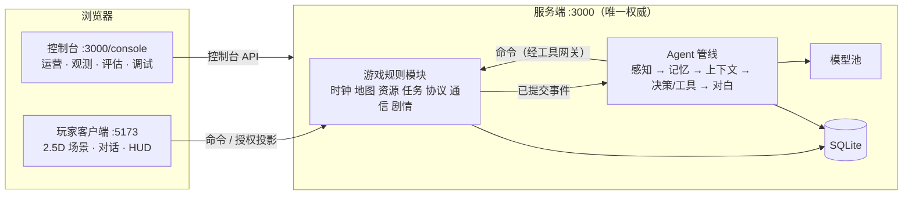

# ai-npc-demo

用来验证游戏中 Agent NPC 的单玩家 demo：一个 TypeScript 全栈的 2.5D 轻数值 SLG，加上一个可观测、可评估、可调试的研究控制台。NPC 要按自己的立场与经历行动；开发者要能查清每个行为来自哪次感知、哪条记忆、哪次模型调用，以及花了多少。

> **状态**：设计完成，尚未实现。仓库目前只有文档（基线 v0.4）；实现从 [构建计划](docs/delivery/build-plan.md) 开始，编码 Agent 请先读 [AGENTS.md](AGENTS.md)。

## 一眼看懂

| 方面 | 首版的样子 |
|---|---|
| 世界 | 2964 年的地球。人类五派与三支新文明（动物后裔巡裔、植物后裔根庭、地外来客泊星者）在中立港口灰港周边共处 |
| 玩家 | 选一个人类派系，作为驻灰港特派员参与首章“水闸之前”（7 个游戏日、6 个地点、3 种资源） |
| NPC | 20 个 Agent 身份：8 个派系战略代表 + 12 位地图角色；三个非人类势力可由控制台里的真人接管 |
| 玩法 | 交谈、出示证据、签协议、邀请角色参与任务、派遣运输/护送/救援/修复/侦察；NPC 会拒绝、讨价还价、记账、主动提醒 |
| 研究 | 首个对比轴是记忆：M0 无长期记忆、M1 结构化账本、M2 观察流与反思、M3 分层混合 |
| 架构 | 宿主只保留“主板”；游戏规则、Agent 认知、模型、工具、界面、控制台页面都是可替换模块 |
| 模型 | 集中模型池按 `(Agent, 用途)` 挂载；提供 OpenAI 兼容协议与 Anthropic Claude 两个参考适配器，外加测试用的确定性适配器 |
| 部署 | 只有两个本地端口：玩家客户端 `127.0.0.1:5173`，服务端与控制台 `127.0.0.1:3000`（`/console`） |



## 一次交互怎么走

1. 玩家对角色岑雁说：“我需要你派人护送隘口那条路。”客户端把它作为命令提交。
2. 世界规则校验并提交事件；玩家在灰港、岑雁在隘口，所以这句话经中继送达，感知模块据此记录她是“经中继听到”的。
3. 岑雁的记忆模块摄入这条观察；调度器为她排一个 turn。
4. turn 冻结输入边界，检索记忆（例如“特派员上次答应送的供给没有送到”），组装上下文。
5. decision 模型可以查询、可以发命令，最后提交立场与“对白意图”，例如“拒绝，理由：上次违约”。
6. 一次独立的 speech 请求只用可以对玩家说的资料生成台词，并经过泄密与状态检查。
7. 台词作为事件提交，玩家看到回复；控制台能沿同一条 trace 看到以上每一步的输入、输出与费用。

## 文档

- [文档入口](docs/README.md)：一页概览、阅读路径、文档地图，以及“哪个主题由哪篇文档负责”。
- [首版范围与不变量](docs/00-scope-and-invariants.md)：做什么、不做什么、术语。
- [构建计划](docs/delivery/build-plan.md)：从空仓库到首版的 26 个步骤。
- [路线与验收](docs/delivery/roadmap-and-acceptance.md)：切片 A（三核心角色闭环）、B（四种记忆对比）、C（完整首版）、M（可插拔验收）。

## 目标仓库结构

```text
apps/        server (:3000) · client (:5173) · console (served at :3000/console)
packages/    contracts · kernel · module-sdk · client-sdk · client-protocol · authority · agent-runtime · experiment · observability
modules/     server/{game,agent,platform,transport}/… · client/… · console/…   (one workspace package per module)
config/      assemblies · profiles · rosters · model-layouts · toolsets · presets · runs · pricing.yaml
content/     world-packs/earth-2964-v1
tests/       contract · integration · catalog · scenarios · e2e · live · fixtures
scripts/     dev · start · check-boundaries · check-catalog · check-docs · check-ports
docs/        design and implementation specs
```

完整目录与规则见 [代码目录](docs/architecture/code-structure.md)。
