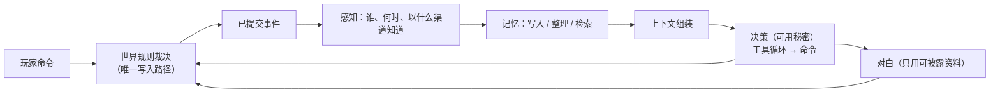

# Agent NPC 设计与验证平台：文档入口

> 文档基线 v0.4，2026-11-18。当前只有设计文档，没有运行时代码与实测数据；实现从 [构建计划](delivery/build-plan.md) 开始，编码 Agent 先读仓库根目录的 [AGENTS.md](../AGENTS.md)。

## 1. 一页看懂

**这是什么**：一个单玩家、统一世界观的 TypeScript 全栈 2.5D 轻数值 SLG。游戏提供选择与后果，平台用来验证 Agent NPC 的记忆、感知、上下文、压缩、模型与行为设计：NPC 要按自己的立场与经历行动，开发者要能查清某个行为来自哪里、花了多少。

**玩家做什么**：在五个人类派系中选一个，作为驻灰港的特派员参与首章“水闸之前”（7 个游戏日）。灰港中继供能不稳、果园缺水、迁徙季临近、外星来客提出交换；玩家通过交谈、出示证据、签协议、邀请角色参与任务、派遣运输/护送/救援/修复/侦察来影响局势。数字只提供约束，乐趣来自 NPC 的反应：他们会记得你守约还是违约，会拒绝、讨价还价，也会主动提醒你。

**谁在行动**：20 个 Agent 身份：8 个派系战略代表（5 个人类派系、3 个非人类势力）与 12 个地图角色。玩家不是 Agent。三个非人类势力可以随时由控制台里的真人接管。

**NPC 怎么运作**：

**平台验证什么**：首个对比轴是记忆：M0 无长期记忆、M1 结构化账本、M2 观察流与反思、M3 分层混合。固定其他条件，比较 NPC 的行动、关系、履约与泄密情况。宿主只保留“主板”机制，游戏规则、Agent 认知、模型、工具、客户端界面与控制台页面都是可替换模块；首版要用四次真实替换证明这一点。

**怎么部署**：只有两个本地端口：玩家客户端 `127.0.0.1:5173`，服务端 `127.0.0.1:3000`（控制台在 `/console`）。浏览器不持有密钥、数据库连接或世界权威。

## 2. 阅读路径

| 你是 | 建议顺序 |
|---|---|
| 想 10 分钟了解项目的人 | 本文第 1 节 → [范围与不变量](00-scope-and-invariants.md) → [背景](game/background.md) → [玩法](game/gameplay.md) → [架构总览](architecture/overview.md) |
| 实现者（人或编码 Agent） | [AGENTS.md](../AGENTS.md) → [范围与不变量](00-scope-and-invariants.md) → [技术栈](delivery/tech-stack.md) → [构建计划](delivery/build-plan.md)，之后按每一步列出的“先读”章节阅读 |
| 研究者与评估者 | [范围与不变量](00-scope-and-invariants.md) 第 3 节 → [记忆](agent/memory.md) → [评估](platform/evaluation.md) → [内容包](game/content-pack.md) 第 11 节 → [观测](platform/observability.md) |
| 运营与剧情策划 | [背景](game/background.md) → [规则](game/rules.md) → [内容包](game/content-pack.md) → [运营](platform/operations.md) |

## 3. 文档地图

“类型”一列：**概念**说明为什么这样设计与必须守住的边界；**规格**给出可以照着实现的精确定义；**手册**给出操作步骤。

| 分区 | 文档 | 回答的问题 | 类型 |
|---|---|---|---|
| 全局 | [范围、不变量与术语](00-scope-and-invariants.md) | 首版做什么、不做什么，哪些规则永远成立 | 概念 |
| 游戏 | [背景与势力](game/background.md) | 世界观、势力、六个地点 | 概念 |
| | [玩法与开局](game/gameplay.md) | 玩家循环、五派开局、界面结构 | 概念 |
| | [角色册](game/characters.md) | 20 个身份与 12 位角色的人格设计 | 概念 |
| | [游戏职能模块](game/systems.md) | 游戏规则按哪些可替换模块划分 | 概念 |
| | [规则与数值](game/rules.md) | 时间、通行、资源、任务、协议、指标的精确规则与测试用例 | 规格 |
| | [内容包](game/content-pack.md) | 地图、角色、库存、剧情卡、名册、实验脚本的全部数据 | 规格 |
| 架构 | [总览与决策](architecture/overview.md) | 系统边界、七项架构决策、故障策略 | 概念 |
| | [领域模型](architecture/domain-model.md) | 命令、事件、状态归属、受众、投影、原因码 | 规格 |
| | [事件、状态与恢复](architecture/events-and-state.md) | 事务、投递、水位、快照与恢复的语义 | 概念 |
| | [存储](architecture/storage.md) | SQLite 表结构、分支复制、事务规则 | 规格 |
| | [公共契约](architecture/contracts.md) | 跨模块共享的类型与错误码 | 规格 |
| | [API](architecture/api.md) | 全部 HTTP 与 WebSocket 接口 | 规格 |
| 模块体系 | [模块边界](architecture/modules.md) | 宿主保留什么、模块之间怎么依赖 | 概念 |
| | [插件机制](architecture/plugins.md) | 描述符、注册、生命周期、不可绕过的 guard | 概念 |
| | [积木组合](architecture/composition.md) | 装配、profile、模型与工具怎样组合并冻结 | 概念 |
| | [模块目录](architecture/module-catalog.md) | 首版有哪些模块、默认装配、替换矩阵 | 规格 |
| | [代码目录](architecture/code-structure.md) | 仓库目录、组合根、新增模块的流程 | 规格 |
| 双端 | [两个端口与三运行域](architecture/two-endpoints.md) | 端口、鉴权、控制台页面 | 规格 |
| | [客户端与 2.5D](architecture/client-and-rendering.md) | 客户端宿主、slot、渲染、交互、HUD、设置 | 规格 |
| Agent | [运行时](agent/runtime.md) | turn 管线、调度、fencing、确定性决策 | 规格 |
| | [记忆](agent/memory.md) | 四种记忆实现的完整算法 | 规格 |
| | [感知](agent/perception.md) | 谁在何时以什么渠道获知什么 | 规格 |
| | [上下文](agent/context.md) | 一次模型调用看到什么、按什么顺序 | 规格 |
| | [压缩与工具视图](agent/compression-and-tool-view.md) | 历史怎样变短、工具结果给模型看多细 | 规格 |
| | [工具](agent/tools.md) | 共享工具、绑定与权限、工具清单 | 规格 |
| | [prompts](agent/prompts.md) | prompt 模板、输出 schema、对白安全门 | 规格 |
| | [模型池](agent/model-pool.md) | 模型挂载、排队、重试、预算 | 规格 |
| | [模型传输](agent/model-transport.md) | OpenAI 兼容、Anthropic、确定性三个适配器 | 规格 |
| 平台 | [配置](platform/configuration.md) | 配置对象、预检、冻结、全部配置文件格式 | 规格 |
| | [观测](platform/observability.md) | 因果链、调用档案、脱敏、控制台观测页 | 规格 |
| | [评估](platform/evaluation.md) | 实验模式、变量控制、探针、指标、报告 | 规格 |
| | [运营](platform/operations.md) | 暂停与存档、三势力席位、剧情卡发布 | 规格 |
| 交付 | [技术栈](delivery/tech-stack.md) | 依赖版本、workspace、脚本、本地拓扑、编码约定 | 手册 |
| | [构建计划](delivery/build-plan.md) | 26 个实施步骤与每步完成判据 | 手册 |
| | [路线与验收](delivery/roadmap-and-acceptance.md) | 切片 A/B/C/M 的范围与验收标准 | 规格 |
| 依据 | [来源与决策](references/sources-and-decisions.md) | 参考了什么、做了哪些关键取舍 | 概念 |

## 4. 负责关系：每个主题只有一个负责文档

其他文档只引用负责文档，不复制它的定义。发现两处说法不一致时，以负责文档为准，并修正另一处。

| 主题 | 负责文档 |
|---|---|
| 范围、数量、术语、memory 基线 | [00-scope-and-invariants](00-scope-and-invariants.md) |
| 游戏规则与数值 | [game/rules](game/rules.md) |
| 初始数据、剧情卡、名册、实验脚本、模板文件结构 | [game/content-pack](game/content-pack.md) |
| 命令、事件、聚合归属、受众、投影、原因码 | [architecture/domain-model](architecture/domain-model.md) |
| 事务、投递、水位、快照的语义 | [architecture/events-and-state](architecture/events-and-state.md) |
| 表结构与分支复制 | [architecture/storage](architecture/storage.md) |
| 通用类型与错误码 | [architecture/contracts](architecture/contracts.md) |
| HTTP 与 WebSocket 接口 | [architecture/api](architecture/api.md) |
| 模块清单、默认装配、替换演示 | [architecture/module-catalog](architecture/module-catalog.md) |
| 目录与包结构 | [architecture/code-structure](architecture/code-structure.md) |
| 端口、鉴权、控制台页面 | [architecture/two-endpoints](architecture/two-endpoints.md) |
| 客户端交互与渲染 | [architecture/client-and-rendering](architecture/client-and-rendering.md) |
| turn 管线、调度、确定性决策 | [agent/runtime](agent/runtime.md) |
| 记忆 / 感知 / 上下文 / 压缩与工具视图 | [agent/memory](agent/memory.md) / [agent/perception](agent/perception.md) / [agent/context](agent/context.md) / [agent/compression-and-tool-view](agent/compression-and-tool-view.md) |
| 工具定义、绑定、工具清单 | [agent/tools](agent/tools.md) |
| prompt 模板与模型输入输出 | [agent/prompts](agent/prompts.md) |
| 模型路由、排队、预算 / 线协议 | [agent/model-pool](agent/model-pool.md) / [agent/model-transport](agent/model-transport.md) |
| 配置文件格式与预检 | [platform/configuration](platform/configuration.md) |
| 观测、档案、脱敏 | [platform/observability](platform/observability.md) |
| 实验、指标、报告 | [platform/evaluation](platform/evaluation.md) |
| 暂停、存档、席位、剧情运营 | [platform/operations](platform/operations.md) |
| realm/kind 依赖白名单、技术栈与源码 header | [delivery/tech-stack](delivery/tech-stack.md) |
| 共享 Agent 工作流、Git 授权与本地补充边界 | [AGENTS.md](../AGENTS.md) |
| 实施顺序与完成判据 | [delivery/build-plan](delivery/build-plan.md) |
| 切片验收 | [delivery/roadmap-and-acceptance](delivery/roadmap-and-acceptance.md) |

## 5. 核心设计一览

- **宿主保留，职能可换**：宿主只负责注册、能力图、生命周期、固定顺序的 guard、版本/幂等/fencing、证据与配置冻结；其余都是模块。模块化管职责，插件化管打包与生命周期，积木化管一次运行的装配与冻结（[模块边界](architecture/modules.md)、[插件机制](architecture/plugins.md)、[积木组合](architecture/composition.md)）。
- **authority 与 policy 分开**：世界规则决定能不能做、结果如何；Agent 决定想不想做、怎么说。模型输出只是提案，结果以规则 receipt 为准（[总览](architecture/overview.md)）。
- **一个世界，各自的视角**：所有主体共享同一份公开世界观，但每个主体只获得自己有资格感知的事；研究员看到的真值不会变成任何 NPC 的知识（[感知](agent/perception.md)、[领域模型](architecture/domain-model.md) 第 7 节）。
- **决策与对白分离**：决策可以用秘密，对白是一次只含可披露资料的新请求，并经过泄密与状态检查（[prompts](agent/prompts.md)）。
- **角色是主体，模型是资源**：模型集中定义，再按 `(agentId, purpose)` 挂载；工具只实现一次，按角色绑定与授权（[模型池](agent/model-pool.md)、[工具](agent/tools.md)）。
- **实验可比较**：每个 run 独占分支并冻结完整 manifest；改变任何可比较条件都是新 run；全部署同时激活的身份不超过 20（[配置](platform/configuration.md)、[评估](platform/evaluation.md)）。

## 6. 文档约定

- 每篇文档开头的“状态”一行说明它是概念还是规格，以及负责范围。
- 文中的数量、阈值、预算与时长都是初始设计值，不是实测最优结论；修改规则数值或内容数据会产生新的内容版本。
- 文档、代码注释与 file header 默认使用中文，保留英文专有名词；代码标识符遵循语言与生态命名惯例。
- 目录、接口、schema 都是目标设计，“实现规格”章节可以照抄实现；不能据此声称系统已经运行、模型已经连接或某种记忆方案更好。
- 修改文档时同步修正引用它的地方，并保证 `pnpm check:docs`（构建计划 S00 实现）报告 0 个坏链接。
